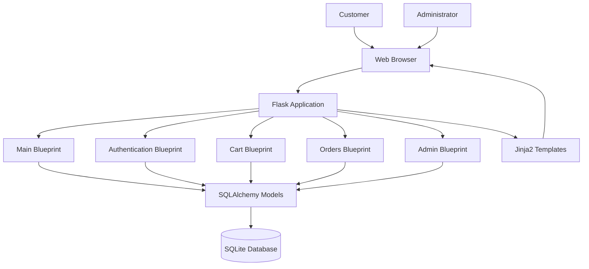
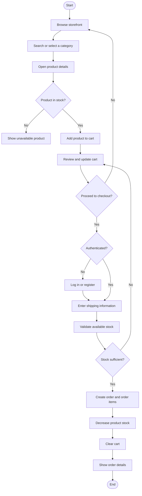
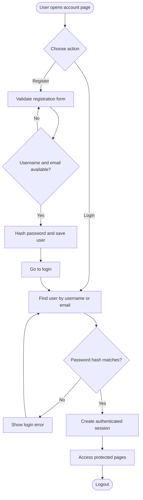
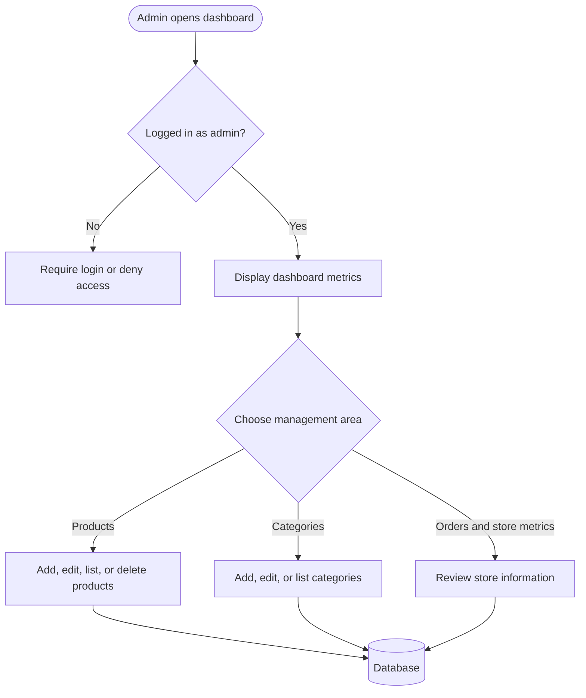
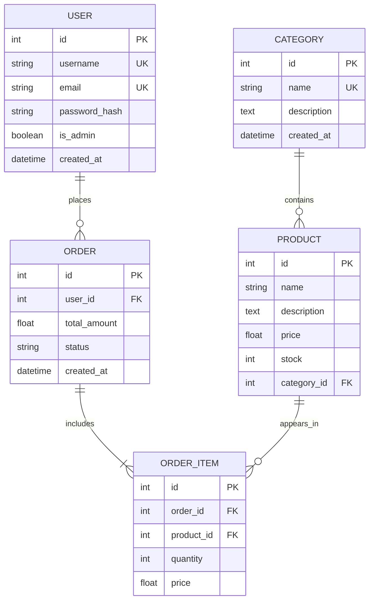

# E-Commerce Platform

A full-stack e-commerce web application built with **Python, Flask, SQLAlchemy, and SQLite**. The application provides product browsing, category filtering, search, session-based shopping carts, authenticated checkout, order history, and an admin area for managing the store.

> **Repository:** [GOMO2005/ecommerce](https://github.com/GOMO2005/ecommerce)

---

## Table of Contents

- [Features](#features)
- [Technology Stack](#technology-stack)
- [Application Architecture](#application-architecture)
- [Application Workflows](#application-workflows)
- [Database Design](#database-design)
- [Project Structure](#project-structure)
- [Getting Started](#getting-started)
- [Run with Docker](#run-with-docker)
- [Sample Data](#sample-data)
- [Routes](#routes)
- [Configuration](#configuration)
- [Security Notes](#security-notes)
- [Future Improvements](#future-improvements)
- [License](#license)

## Features

### Customer features
- Browse featured products and product categories.
- View product details and related products.
- Search products by name or description.
- Add products to a shopping cart.
- Update quantities and remove cart items.
- Complete checkout after signing in.
- View personal order history and order details.

### Authentication
- User registration and login.
- Login using username or email.
- Password hashing with Werkzeug.
- Session-based login management.
- Protected checkout and order pages.

### Administration
- Admin-only dashboard with store statistics.
- View and manage products.
- Add, edit, and delete products.
- Manage product categories.
- View order and user-related store metrics.

### Application foundation
- Flask application factory (`create_app`).
- Blueprint-based route organization.
- SQLAlchemy database models.
- CSRF protection through Flask-WTF.
- Custom 404 and 500 error pages.
- Docker image configured to run with Gunicorn.

## Technology Stack

| Layer | Technologies |
|---|---|
| Backend | Python 3.12, Flask 3 |
| Database / ORM | SQLite, Flask-SQLAlchemy |
| Authentication | Flask-Login |
| Forms and validation | Flask-WTF, WTForms, email-validator |
| Security utilities | Werkzeug password hashing, CSRF protection |
| Frontend | HTML templates, Jinja2, CSS |
| Production server | Gunicorn |
| Containerization | Docker |

## Application Architecture

The application uses Flask's application factory pattern. Feature-specific Blueprints separate the main storefront, authentication, cart, order, and admin functionality.



### Request lifecycle

1. A customer or administrator sends an HTTP request from the browser.
2. Flask routes the request to the matching Blueprint.
3. The route validates input and checks authentication or admin permissions when required.
4. SQLAlchemy reads or updates application data.
5. Flask renders a template or redirects the browser with a response.

## Application Workflows

### Shopping and checkout



### Authentication workflow



### Admin workflow



## Database Design

The data layer is implemented with SQLAlchemy models. The main entities include users, categories, products, orders, and order items.



**Relationship overview**

- A user can place multiple orders.
- A category can contain multiple products.
- An order contains its order items.
- Each order item references a product and stores the purchase quantity and price.

The cart is stored in the Flask session; it is not represented as a separate persistent cart table in the current implementation.

## Project Structure

```text
ecommerce/
├── app.py                 # Flask application factory and startup
├── config.py              # Application configuration
├── extensions.py          # SQLAlchemy, LoginManager, CSRF
├── forms.py               # WTForms definitions and validation
├── models.py              # Database models
├── seed.py                # Sample database data
├── wsgi.py                # WSGI entry point for Gunicorn
├── requirements.txt       # Python dependencies
├── Dockerfile             # Container build instructions
├── .dockerignore
├── .gitignore
├── k8s/                   # Kubernetes-related configuration
├── routes/
│   ├── main.py            # Storefront, categories, products, search
│   ├── auth.py            # Registration, login, logout
│   ├── cart.py            # Shopping cart operations
│   ├── orders.py          # Checkout and order history
│   └── admin.py           # Admin dashboard and management
├── static/
│   ├── css/
│   └── uploads/           # Product upload directory
└── templates/
    ├── admin/
    └── ...                # Jinja2 page templates
```

## Getting Started

### Prerequisites

- Python 3.12 recommended.
- Git.
- pip.

### 1. Clone the repository

```bash
git clone https://github.com/GOMO2005/ecommerce.git
cd ecommerce
```

### 2. Create a virtual environment

**Windows (PowerShell):**

```powershell
python -m venv venv
.\venv\Scripts\Activate.ps1
```

**Linux / macOS:**

```bash
python3 -m venv venv
source venv/bin/activate
```

### 3. Install dependencies

```bash
pip install -r requirements.txt
```

### 4. Configure environment variables

The application reads configuration from environment variables. Set a strong secret key before running it.

**Windows (PowerShell):**

```powershell
$env:SECRET_KEY = "replace-with-a-long-random-secret"
```

**Linux / macOS:**

```bash
export SECRET_KEY="replace-with-a-long-random-secret"
```

The default database is SQLite (`ecommerce.db`) in the project directory. The application also supports a `DATABASE_URL` environment variable.

### 5. Initialize the database

The WSGI entry point creates database tables when it is imported. You can initialize the database explicitly with:

```bash
python -c "from app import create_app; from extensions import db; app=create_app(); app.app_context().push(); db.create_all()"
```

### 6. (Optional) Load sample data

```bash
python seed.py
```

See [Sample Data](#sample-data) for the development-only sample accounts.

### 7. Start the application

```bash
python app.py
```

Open [http://127.0.0.1:5000](http://127.0.0.1:5000) in your browser.

> The development entry point runs with Flask debug mode enabled. Do not use it as a production server.

## Run with Docker

Build the image:

```bash
docker build -t gomo-ecommerce .
```

Run the container:

```bash
docker run --name ecommerce-app \
  -p 5000:5000 \
  -e SECRET_KEY="replace-with-a-long-random-secret" \
  -v ecommerce-data:/app \
  gomo-ecommerce
```

Open [http://localhost:5000](http://localhost:5000).

The Dockerfile uses `python:3.12-slim`, installs the requirements and Gunicorn, and starts the WSGI application on port `5000`.

> **Persistence note:** The example volume mounts `/app`, which also contains application code. For a production deployment, use a dedicated persistent location for the database and uploads, and configure the application paths accordingly. Back up persistent data.

## Sample Data

Run `python seed.py` to create sample categories, products, and development accounts if the database has not already been seeded.

The seed script currently defines these sample login credentials:

| Role | Username | Password |
|---|---|---|
| Admin | `admin` | `admin123` |
| Customer | `john` | `password123` |

**Development only:** These credentials are publicly visible in the seed script. Never use them in a deployed environment. Change or remove them before making a deployment accessible to others.

## Routes

The following route groups are registered by the application.

| Blueprint | URL prefix | Purpose |
|---|---|---|
| Main | `/` | Home page, categories, product details, search |
| Authentication | `/auth` | Registration, login, logout |
| Cart | `/cart` | View, add, update, remove, and clear cart |
| Orders | `/orders` | Checkout, order list, order details |
| Admin | `/admin` | Admin dashboard and store management |

### Important endpoints

| Method | Endpoint | Description |
|---|---|---|
| GET | `/` | Storefront |
| GET | `/category/<category_id>` | Products in a category |
| GET | `/product/<product_id>` | Product details |
| GET | `/search?q=<term>` | Search products |
| GET, POST | `/auth/register` | Register |
| GET, POST | `/auth/login` | Log in |
| GET | `/auth/logout` | Log out |
| GET | `/cart/` | View cart |
| POST | `/cart/add/<product_id>` | Add product |
| POST | `/cart/update` | Update quantities |
| GET | `/cart/remove/<product_id>` | Remove product |
| GET | `/cart/clear` | Clear cart |
| GET, POST | `/orders/checkout` | Checkout (login required) |
| GET | `/orders/` | Current user's orders |
| GET | `/orders/<order_id>` | Order details (owner or admin) |
| GET | `/admin/` | Admin dashboard (admin required) |

## Configuration

| Variable | Purpose | Default |
|---|---|---|
| `SECRET_KEY` | Flask session and CSRF signing key | Development fallback in `config.py` |
| `DATABASE_URL` | SQLAlchemy database connection string | SQLite database at `ecommerce.db` |

Additional configuration in `config.py` includes:

- Upload directory: `static/uploads/`.
- Maximum request size: 16 MB.
- SQLAlchemy modification tracking disabled.

## Security Notes

Before deploying this project publicly:

1. Set a strong, unique `SECRET_KEY` using environment configuration. Remove the fallback development secret from production configuration.
2. Replace the sample admin and customer credentials; never publish real credentials.
3. Disable Flask debug mode and run through a production WSGI server such as Gunicorn.
4. Use HTTPS and secure cookie settings behind a correctly configured reverse proxy.
5. Validate uploaded files by type, size, and content; store uploads safely.
6. Review state-changing routes. Prefer POST for operations such as logout, cart removal, and cart clearing, and ensure CSRF protection is active on all forms.
7. Add transaction handling and concurrency-safe stock updates for checkout.
8. Use a production database and reliable backups when handling real orders and customer information.

This README describes the repository's visible implementation; it is not a security audit or a claim that the application is production-hardened.

## Future Improvements

Potential next steps for the project:

- Integrate a payment gateway with verified payment callbacks and order reconciliation.
- Add automated tests for authentication, cart, checkout, stock, and admin permissions.
- Add product image upload validation and image storage configuration.
- Add order status management and customer notifications.
- Add pagination and filtering improvements for the admin area.
- Add database migrations with Flask-Migrate.
- Add CI workflows, structured logging, monitoring, and deployment documentation.
- Review and document the Kubernetes manifests and production deployment configuration.

## License

No license is specified in the repository at the time this README was prepared. Add a `LICENSE` file if you intend to distribute the project under an open-source license.
